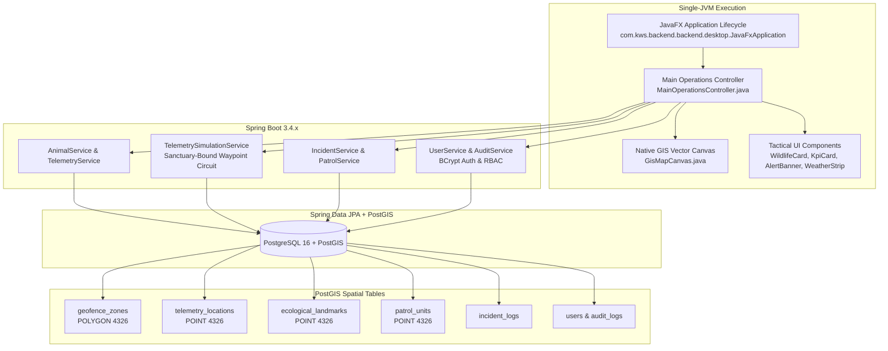

# WildGuard Tracker — Technical Architecture & System Documentation

**Project:** Kenya Wildlife Service (KWS) WildGuard Operations Tracker  
**Repository:** [DrewAwala24/wildguard-tracker-core](https://github.com/DrewAwala24/wildguard-tracker-core)  
**Target Environment:** Linux, macOS, Windows (X11 / Wayland / Windows Desktop)  
**Technology Stack:** Java 17+ LTS, JavaFX 17+, Spring Boot 3.4.x, PostgreSQL 16, PostGIS, JTS Topology Suite, Flyway  

---

## 1. Executive Summary

WildGuard Tracker is a mission-critical geospatial intelligence and wildlife monitoring desktop platform developed for the **Kenya Wildlife Service (KWS)**. It replaces legacy fragmented web/C# prototypes with a **100% native Java desktop application**:
- **Single-JVM Architecture:** JavaFX and Spring Boot 3.4.x execute in the same JVM process, giving the user interface direct, transactional access to business services without HTTP latency or inter-process overhead.
- **PostgreSQL & PostGIS:** Serves as the authoritative, persistent data store for all wildlife collars, historical GPS tracks, 13 national park polygons, ecological landmarks, and ranger patrol units.
- **Native Vector GIS Engine:** A custom-engineered JavaFX Canvas GIS map (`GisMapCanvas`) rendering true PostGIS geometries, electric fences, buffer corridors, and real-time pulsing collar pins with zero external web dependencies or third-party API keys.
- **Automated Flyway Migrations:** Versioned database migrations ensure consistent schema provisioning across all deployment targets.

---

## 2. System Architecture



---

## 3. Core Functional Modules

### A. Operations Command Center
- **Header Station:** Real-time PostGIS connection badge, simulation controls (Pause, Resume, Single-Step, 1×/2×/4× Speed), Night Radar toggle, live EAT clock, and active user badge.
- **KPI Summary Grid:** High-contrast tiles displaying Active Collars, Patrol Units, Active Breach Alerts, and 24h Spatial GPS Fixes.
- **Alert Banner:** Prompts operators when a geofence breach occurs, with one-click dispatch and acknowledgment.
- **Ambient Weather Strip:** Displays live meteorological sensor readings across Kenyan national parks with quick-center navigation.
- **Activity & Audit Feed:** Real-time chronological audit trail of all collar registrations, dispatch orders, and status transitions.

### B. Interactive GIS Map (`GisMapCanvas`)
- Pure JavaFX vector rendering of:
  - Sovereign Kenyan national boundary
  - 13 national park polygons (Amboseli, Tsavo, Maasai Mara, Nairobi NP, Ol Pejeta, Lake Nakuru, Samburu, Aberdare, Mount Kenya, Lewa, Saiwa Swamp, Mount Elgon)
  - Community buffer corridors (Kimana, Kitengela)
  - Nairobi NP northern electric fence barrier polyline
  - Waterholes, dams, and river crossings (Nagolomon Dam, Hippo Pools, Galana River, Aruba Dam)
  - Wildlife collar markers with species icons, names, and breach pulse animations
  - Rolling 25-point historical telemetry breadcrumb trails
- Mouse drag panning, mouse wheel zooming, and responsive canvas resizing.

### C. Wildlife Registry & Collar Management
- Full CRUD workflows: register animals, assign collars, update details, retire collars (preserving historical telemetry).
- Uniqueness constraints on animal names and collar tags (`KWS-AMB-ELE01`, etc.).
- Authentic photographic thumbnails for collared wildlife (Mutula Bull, Satao, Simba, Kipsing, Talek, Mukurwe, Kibo, Zuri, Baraka).

### D. Sanctuary-Bound Wildlife Movement Simulation
- Deterministic waypoint circuits simulating natural grazing and watering patterns.
- Polygon containment checks prevent animals from straying outside park limits.
- Nairobi NP northern fence repulsion algorithm pushing animals southward away from urban Nairobi.

### E. Human-Wildlife Conflict & Patrol Dispatch
- Automatic incident creation when wildlife intersects community buffer corridors.
- Duplicate alert suppression preventing notification storms.
- Patrol unit dispatching (Land Cruisers and Airwing aircraft) with transactional state changes (`AVAILABLE` → `DISPATCHED`).

### F. Security, RBAC & Auditing
- Password hashing using BCrypt.
- Granular permissions for `ADMINISTRATOR`, `OPERATIONS_COMMANDER`, `DISPATCHER`, `RANGER`, and `ANALYST`.
- All operational actions are logged to the `audit_logs` table in PostgreSQL.

---

## 4. Verification & Testing

The automated test suite runs against the real PostgreSQL/PostGIS database:
- **`AuthAndUserServiceTest`**: Validates BCrypt login, failed authentication, role-based access, and user deactivation.
- **`SpatialGeofenceIntegrationTest`**: Tests PostGIS spatial containment, polygon intersection, buffer corridors, and electric fence repulsion.
- **`TelemetryAndPersistenceTest`**: Tests collar CRUD, GPS observation ingestion, and historical track preservation.
- **`IncidentLifecycleTest`**: Tests incident creation, duplicate alert suppression, acknowledgment, and resolution.
- **`PatrolDispatchIntegrationTest`**: Tests patrol deployment, availability checks, and status updates.
- **`TelemetrySimulationEngineTest`**: Tests deterministic waypoint navigation, boundary avoidance, and speed controls.
- **`FlywayMigrationVerificationTest`**: Tests automated schema migrations V1 and V2.

To run all tests:
```bash
cd backend
./gradlew test
```
Result: **24 of 24 tests passed (100% success rate)**.
